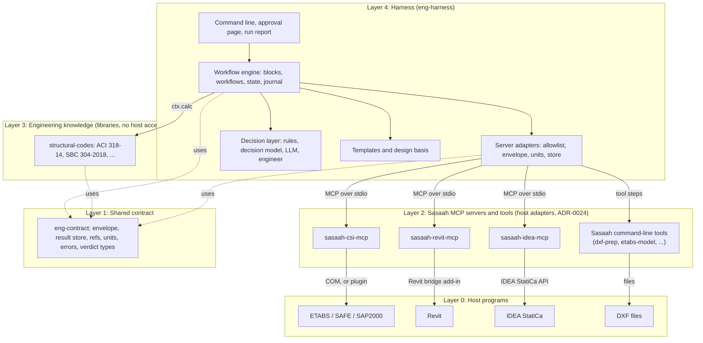
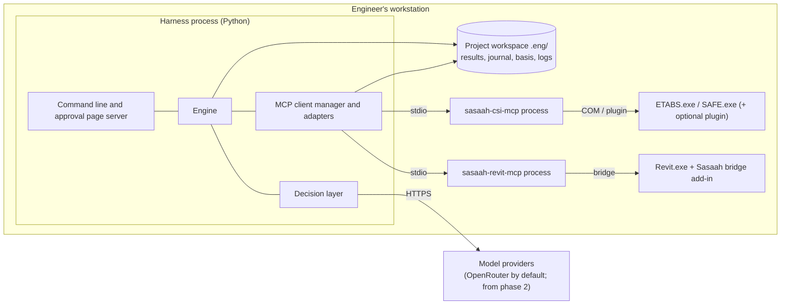

# 02. System Overview

Status: Proposed; Layer 2 is provided by the existing Sasaah servers (ADR-0024) · Applies to: every repository

## 1. Layers

Dependency rule: a layer may depend only on layers below it. Layer 2 servers never depend on each other,
on Layer 3, or on Layer 4. Layer 3 never touches a host program. The shared contract (Layer 1) depends on nothing
except the Python standard library and Pydantic. The Layer 2 servers belong to the Sasaah repository and do not speak
the contract; the harness adapters map their results into it
([ADR-0024](../adr/0024-harness-on-existing-sasaah-servers.md)).

## 2. Components and responsibilities

| Component | Responsibility | Never does |
|---|---|---|
| **eng-contract** | Defines and implements the tool result envelope, the result store, `$ref` resolution, canonical units, error codes, and verdict types | Talk to a host program; hold engineering logic |
| **MCP servers** (Sasaah) | Translate small typed tool calls into host program API calls; validate inputs; return raw values and model-integrity issues | Run workflows, make decisions, evaluate code clauses, call other servers (the target, [ADR-0003](../adr/0003-mcp-servers-are-pure-adapters.md)) |
| **Server adapters** (harness) | Allow only listed tools; wrap results in the envelope with canonical units and provenance; store them; resolve `$ref` inputs; check server builds at run start | Change a value; call a tool outside the list |
| **structural-codes** | Evaluate code clauses: given inputs with units, return verdicts with a full calculation trace | Read or write models; call language models |
| **Harness engine** | Run blocks and workflows deterministically; enforce check-after-write; persist every step; resume after failure | Contain host API code; compute engineering values outside code packs and approved harness calcs |
| **Decision layer** | Choose between typed options using rules, then a decision model, then a language model, then the engineer | Produce engineering numbers |
| **Templates and design basis** | Hold project parameters (code, materials, sections, combinations, limits) with the source of every value | Fill a missing value silently |
| **Command line and HTML pages** | Start and follow runs; collect approvals, engineer inputs and sign-off on the approval page; show the run report ([ADR-0027](../adr/0027-phase-1-interface.md)) | Execute engineering logic |

## 3. Runtime topology

- The harness starts each MCP server as a child process over stdio (inside a Job Object, so servers end with the
  harness). Server results enter the project workspace through the adapters, which give each one a `result_id`
  (see [04-tool-contract](04-tool-contract.md) §3).
- Any other MCP client (a chat agent, an IDE) can start the same servers; it gets their raw replies, without the store.
- Exactly one server process per host program instance. Two servers never drive the same host instance.
- Host programs are started by the engineer, or by the server at the engineer's request, always at normal
  integrity level.

## 4. A typical step, end to end

Example: "read column forces in ETABS, check them against ACI 318-14".

1. The engine calls `csi_results_frame_forces` of `sasaah-csi-mcp` with
   `{"combos": {"$ref": "res_01JB7YX...#/combinations/ultimate"}}`, where the reference points into the design basis.
2. The adapter resolves the `$ref` from the workspace store and calls the server. It converts the reply to canonical
   units, writes the full table as a neutral `forces.member_end/1` result, and returns an envelope with `result_id`, a
   short `summary`, and `provenance`.
3. The engine calls `ctx.calc("aci318_14.22_4_2.axial_flexure_interaction", forces=<result_id>, sections=<result_id>)`.
   The code pack reads both results from the store, evaluates every column, and stores verdicts plus the
   calculation trace as a new result.
4. The engine reads only the verdict summary (P3). If any status is `FAIL`, it reaches a decision point
   ([12-decision-layer](12-decision-layer.md)). No number was typed by any agent at any point.

## 5. Trust boundaries

| Boundary | Risk | Control |
|---|---|---|
| Harness to model providers (internet) | Data leaves the machine; provider output is untrusted | Provider layer with redaction policy; typed outputs only; outputs are choices, never numbers ([16](16-security-safety-privacy.md)) |
| Input files (DXF, Excel, PDF) to tools | File text can contain instructions aimed at agents | File text is data. It is never placed in an instruction position; it is passed only as quoted, typed fields |
| MCP server to host program | Host freezes, modal dialogs, unknown outcomes, units left changed | Timeouts with `TIMEOUT_UNKNOWN_OUTCOME`, idempotency keys, dialog suppression, single writer per host (targets for the Sasaah servers); meanwhile the harness works on copies, saves before analysis, reconciles after timeouts, checks units after them and allows one driver per host instance ([ADR-0024](../adr/0024-harness-on-existing-sasaah-servers.md), [11](11-harness-engine.md) §6) |
| Harness to Sasaah servers | A new server build changes a tool's behavior or output | Build and tool-list check at run start; adapters pinned to tested builds; contract tests on recorded replies; script and table-write tools never allowed ([11](11-harness-engine.md) §9) |
| Developers (human or agent) to repositories | Unreviewed or improvised code reaches engineering results | The process: specs, tests, reviews, engineering sign-off, CI gates ([process](../../process/README.md)) |
| Project-lane tools to live projects | Unreviewed code changes a project model | Copies only, a test for every number, marked results, release lane before reuse ([ADR-0026](../adr/0026-project-lane-for-tools.md)) |

## 6. Where things live

| Concern | Lives in |
|---|---|
| How to talk to ETABS | `sasaah-csi-mcp` in the Sasaah repository; its adapter in `eng-harness` |
| Which tools exist and their schemas | Each server's source code; each adapter lists the tools workflows may call |
| What ACI 318-14 §22.5 says, as an executable check | `structural-codes` |
| The order of steps for the model edit cycle | `eng-harness` workflows |
| Which decision to take when a check fails | Workflow rules first, then the decision layer |
| Project parameters | The project's design basis, built from a template plus engineer input |
| How code gets written, reviewed and released | This hub's `process/` folder, copied into each repository's `AGENTS.md` |
