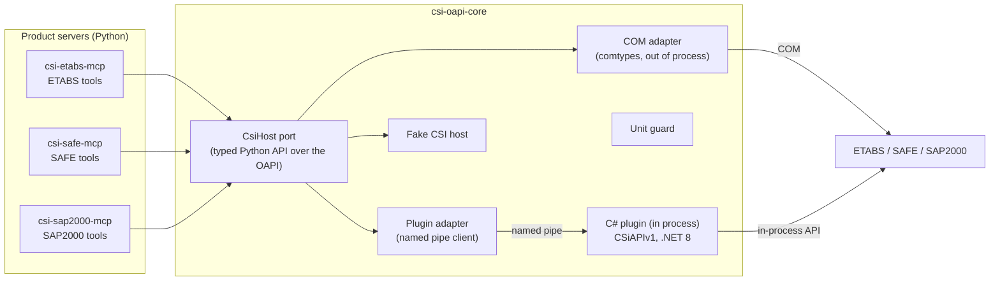

# 06. CSI Servers: ETABS, SAFE, SAP2000

Status: Superseded as a build plan by ADR-0024: the harness uses Sasaah's `Sasaah.Csi.Engine` and `sasaah-csi-mcp`. The rules below remain the target when extending them · Repositories: `csi-oapi-core`, `csi-etabs-mcp`, `csi-safe-mcp`, `csi-sap2000-mcp`

## 1. Shape

- `csi-oapi-core` holds everything the three products share: the typed Python port over the OAPI, the two real
  adapters, the fake host, the unit guard, the op ledger, return-code handling, model identity, and the C# plugin
  source. In phase 1 only the COM adapter and the fake host are built; the plugin follows in phase 2.
- Each product server holds only its tools, its product-specific services, its `check_model` list and its kinds.
- The three servers are independent packages. A user who only has SAFE installs only `csi-safe-mcp`.

## 2. Choosing the adapter

| | COM adapter (default) | Plugin adapter (optional) |
|---|---|---|
| How | Python `comtypes` attaches to the running host through the CSI helper object, or starts one | A C# plugin loaded by the host (Tools menu) opens a named pipe; Python sends operations to it |
| Install | Nothing extra beyond the server | The plugin is registered once in the host |
| Speed | Each API call crosses processes | Batches run inside the host process; large models are much faster |
| Use when | Default for everything; always available | Bulk edits (thousands of objects), large result extraction |

Selection: the server checks for a live plugin pipe for the target instance at startup and on reconnect. If found and
the handshake versions match, it uses the plugin for operations the plugin supports and COM for the rest. The
choice is reported by `get_server_info` and recorded in provenance. Results are identical whichever adapter is used;
contract tests run the same suite against both.

## 3. The plugin

- C# class library on .NET 8, implementing the host plugin contract (`cPluginContract`), referencing the
  cross-product `CSiAPIv1` library from the local installation so one plugin binary serves ETABS, SAFE and SAP2000.
  This cross-product claim is verified by spike S-03 before it is relied on.
- On start, it opens the pipe `csi-bridge-<product>-<pid>` and stays resident until the engineer closes it or the
  host exits.
- Wire format: length-prefixed UTF-8 JSON frames (4-byte length header). Never newline-delimited.
- Handshake: plugin version, wire protocol version, host product and version. A mismatch disables the plugin path
  with a warning; COM still works.
- It executes a **fixed allowlist of operations** defined in `csi-oapi-core` (the same operations the COM adapter
  implements). It never executes arbitrary method names, reflection calls, or scripts. The allowlist is internal
  between the adapter and the plugin and is never exposed as a tool.
- Threading: operations run on the thread the host requires for API calls, determined by spike S-03.

## 4. Host session rules

- One session per host instance (see [05](05-mcp-server-standard.md) §7). Instance selection by process id when
  more than one instance runs.
- All COM calls run on one STA worker thread with COM initialized once.
- Every OAPI call's return code is checked. A non-zero code becomes `HOST_ERROR` with `host_code` and the API
  method name. No call is "fire and forget".
- The model must be saved to a path before analysis. The server reports `PRECONDITION_FAILED` with
  `precondition: model_saved` instead of letting the host fail.
- `create_model` produces a defined starting state. Whatever the host adds to a new model by default (materials, load
  patterns, sections) is reported in the change set; `define_*` tools treat an existing definition with identical
  values as already applied and one with different values as `CONFLICT`. The exact defaults per host version are
  recorded in spike S-01 and in the fake host.
- `create_model` is followed by `save_model_as` into the run folder before any other write, so the model has a path,
  a stamped identity and a backup point from the start.
- Modal dialogs: the watchdog of [05](05-mcp-server-standard.md) §7 applies; ETABS dialogs otherwise block COM calls
  indefinitely. Its detection method is verified in spike S-01.

## 5. Unit guard

Units were the most dangerous failure in the earlier project. The rule is simple and absolute:

1. Before a batch of calls, the guard reads the host's present units and **writes them to a guard record** in
   `<workspace>/.eng/state/units/<model_id>.json` (open).
2. It sets the working units the adapter expects (kN, mm, °C).
3. It runs the batch.
4. In a `finally` block, it restores the original units, **reads them back to verify**, and closes the guard record.
5. If restore or verification fails, the session enters the `unit_state_unknown` state, persisted in the guard record:
   every further write is refused with `PRECONDITION_FAILED` (`precondition: units_verified`) until the engineer
   confirms the units.
6. At startup and on reconnect, a server that finds an **open** guard record (the previous process was killed or a
   call hung) restores the recorded original units first, verifies them, and closes the record before any other call.

Values arriving from the host are converted to canonical units ([04](04-tool-contract.md) §4) in one place, the
adapter's conversion layer. Moments arrive in kN·mm and leave as kN·m.

## 6. Model identity and revisions

- `model_id`: the stamped identity ([04](04-tool-contract.md) §3.3), written into the model's project information on
  creation or first attach. A working copy gets a new identity with `derived_from`.
- `model_revision`: a counter in `<workspace>/.eng/state/models/<model_id>.json`, incremented on every write this
  server performs.
- Outside edits (the engineer editing in the host's window) cannot always be detected through the API. The server
  takes a fingerprint at `get_model_status`, `check_model` and before every write: object counts per type, assigned
  section and property names per object type, load pattern and combination definitions, and the file save time. A
  changed fingerprint without a server write increments the revision and adds `MODEL_CHANGED_OUTSIDE`. Spike S-04
  measures how reliable and how fast this is. The harness's default "work on a copy" mode reduces the risk
  ([11](11-harness-engine.md) §7).

## 7. ETABS tool set for phase 1

Phase 1 covers what the DXF-to-ETABS slice needs ([18](18-first-slice-dxf-to-etabs.md)), plus core reads and
results. The exact list is fixed by the tool specs during the spec stage; this is the intended scope.

| Toolset | Tools (without the `etabs_` prefix) |
|---|---|
| file | `create_model`, `open_model`, `save_model`, `save_model_as` |
| define | `define_stories`, `add_grid_system`, `define_materials`, `define_frame_sections`, `define_area_sections`, `define_load_patterns`, `define_load_combinations`, `define_diaphragms`, `define_mass_source` |
| edit | `add_frames`, `add_areas`, `assign_frame_sections`, `assign_frame_local_axes` (rotated columns), `assign_area_sections`, `assign_restraints`, `assign_diaphragms`, `assign_area_loads`, `assign_frame_loads`, `delete_objects` |
| read | `list_stories`, `list_grids`, `list_frames`, `list_areas`, `list_joints`, `list_sections`, `list_materials`, `list_load_patterns`, `list_load_combinations` |
| analysis | `run_analysis`, `get_analysis_messages` |
| results | `get_joint_reactions`, `get_frame_forces`, `get_story_drifts`, `get_modal_results`, `get_joint_displacements` |

ETABS `check_model` list (initial): frames or areas without a section; joints not connected to any object; duplicate
joints within tolerance; overlapping duplicate frames; zero-length frames; structure without restraints; load
combinations referencing missing patterns or cases; missing mass source; areas outside any story; analysis warnings and
instability messages from the last run.

## 8. SAFE and SAP2000

SAFE is built in phase 2 and SAP2000 in phase 3, on the same core. SAFE adds slabs, soil supports, punching shear
output and strip results; SAP2000 adds general frame, shell and cable modeling. Their tool lists and `check_model` lists
are written in their own specs when their phases start, using the same vocabulary and toolsets. Write tools accept
neutral `model.*` kinds ([04](04-tool-contract.md) §6), so forces or placements prepared for one CSI program can be
translated by harness calcs for another.

## 9. What stays out

- No `run_script`, `invoke`, generic object setter, or table-apply tool.
- No database-table writes. A read-only `list_table` tool may be added by ADR if a needed read has no typed API.
- No design-code verdicts: host-native design results are returned as raw host output in the `host_design` toolset
  and are used for cross-checking code packs, never as the harness's verdict.
