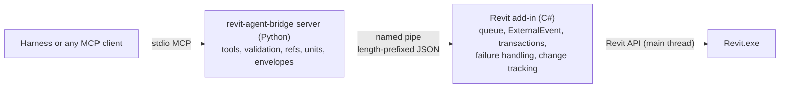

# 07. Revit Server: `revit-agent-bridge` (working name)

Status: Superseded as a build plan by ADR-0024: the harness uses Sasaah's Revit bridge and `sasaah-revit-mcp`. The properties below remain the target when extending them · Phase 3 · Languages: Python (MCP server), C# (Revit add-in)

## 1. Shape

The add-in is deliberately thin: it executes a fixed allowlist of operations on Revit's main thread and returns raw
values in Revit's internal units, each tagged with its unit. Everything else (tool schemas, validation, references,
unit conversion, envelopes, the result store) is in the Python server, through `eng-contract`. This keeps one
implementation of the contract and lets contributors work in Python ([ADR-0010](../adr/0010-revit-thin-addin-python-front.md)).

## 2. What makes it better than existing Revit MCP servers

Existing open-source Revit MCP servers expose many loosely typed commands. This server is different by design:

| Property | This server |
|---|---|
| Typed schemas | Every parameter typed, with units and bounds; no "type_id or type_name" prose |
| Pass by reference | Accepts `$ref` inputs, for example column dimensions from a code-pack result |
| Atomic writes | One tool call is one transaction group: all or nothing |
| True dry run | The change is applied inside a transaction group and rolled back, returning the exact change set |
| Honest outcomes | `TIMEOUT_UNKNOWN_OUTCOME` with `reconcile_operation`; no silent partial edits |
| No frozen queues | Failure preprocessing and dialog handling keep Revit from blocking on modal dialogs |
| Change tracking | Revisions follow Revit's own document change events, so outside edits are detected |
| Language independence | Parameters are addressed by built-in parameter id or shared parameter GUID, never by display name, so it works with any Revit UI language |
| `check_model` | Structural integrity issues reported in contract form |

## 3. The add-in

- C# class library. Revit 2025 and newer run on .NET 8 (`net8.0-windows`); Revit 2024 and older use .NET Framework 4.8.
  The project is multi-target ready; only the latest Revit version is built and tested at first
  ([17](17-versioning-and-compatibility.md)).
- Compile-time references come from NuGet reference packages so CI can build without Revit installed. Their license
  terms are verified in spike S-06; if they are not acceptable, CI builds use a self-hosted runner with Revit.
- On startup it writes an instance record `%LOCALAPPDATA%\revit-agent-bridge\instances\<pid>.json` (Revit version,
  add-in version, pipe name, open documents) and removes it on shutdown. The Python server uses these records to find
  and select instances.
- It adds its panel to the shared **Sasaah Studio** tab ([15](15-desktop-addins.md) §2) with status and a pause button.

## 4. Wire protocol

- Pipe name `revit-agent-bridge-<pid>`, current user only (pipe security restricted to the user's SID).
- Frames: 4-byte length header plus UTF-8 JSON. Request `{id, op, args, op_id, dry_run, deadline_ms}`; response
  `{id, ok, data | error, warnings, changes}`.
- Handshake on connect: wire protocol version, add-in version, Revit version. Mismatch is refused with a clear error.

## 5. Execution model

- Requests enter a bounded queue (depth 32; full queue returns `HOST_BUSY`).
- An `ExternalEvent` executes one request at a time in Revit's API context.
- Each write runs in a `TransactionGroup` that is assimilated on success or rolled back on any error. Dry runs always
  roll back.
- Deadlines: if Revit does not start a request before its deadline, it is dropped and reported as
  `TIMEOUT_NO_EFFECT`. If a request started and its response is late, the server reports
  `TIMEOUT_UNKNOWN_OUTCOME`, and `reconcile_operation` answers from the add-in's journal of `op_id` outcomes.

## 6. Failure and dialog handling

- Every transaction uses a failures preprocessor: warnings are collected and returned as contract warnings; errors
  cause rollback and a `HOST_ERROR` that lists Revit's failure messages.
- A dialog handler answers known Revit dialogs with documented, conservative defaults and reports each one as a
  warning.
- If a modal dialog the add-in did not open is showing (the engineer is working), the add-in does not execute and
  answers `HOST_BUSY` with `host_code: MODAL_DIALOG`.

## 7. Identity, revisions, units

- Elements are identified by `unique_id` (stable) plus `element_id`. Payloads always carry both. Elements created by
  the server also carry an extensible-storage stamp with the `op_id` and item index, used by reconciliation.
- `model_id` is the stamped identity ([04](04-tool-contract.md) §3.3), stored in extensible storage on the project
  information element. It does not depend on the path or on Revit's version GUID, which changes on every save.
- `model_revision` increments on every committed change seen through `DocumentChanged`, whether it came from this
  server or from the engineer. Changes inside transaction groups that the add-in rolls back (dry runs, failed writes)
  are excluded, so a dry run never makes references stale.
- The add-in returns Revit internal units (feet, square feet, radians) tagged per value. The Python server converts
  them to canonical units with `eng-contract.units`. The add-in never converts.

## 8. Tool scope for phase 3 (intended; fixed by tool specs)

Write tools accept neutral `model.*` kinds ([04](04-tool-contract.md) §6), for example section dimensions produced by a
code-pack design result, translated by a harness calc.

| Toolset | Tools (without the `revit_` prefix) |
|---|---|
| read | `list_documents`, `list_levels`, `list_grids`, `list_structural_columns`, `list_structural_framing`, `list_walls`, `list_floors`, `list_foundations`, `list_family_types`, `get_element_parameters`, `get_element_geometry` |
| define | `create_family_type`, `set_family_type_parameters`, `create_levels`, `create_grids` |
| edit | `add_structural_columns`, `add_structural_framing`, `add_walls`, `add_floors`, `add_foundations`, `set_element_type`, `set_element_parameters`, `move_elements`, `delete_elements` |
| file | `open_document`, `save_document`, `save_document_as` |
| results | `list_analytical_members`, `get_analytical_model` |

`check_model` (initial): structural elements without a type, columns not attached to levels, framing with zero length,
duplicate elements at the same location, elements on a missing or deleted level, analytical members disconnected from
their physical elements.

Sheets, views and documentation output are out of scope; they belong to `revit-sheet-exporter`.
