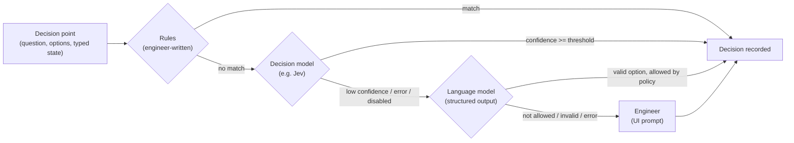
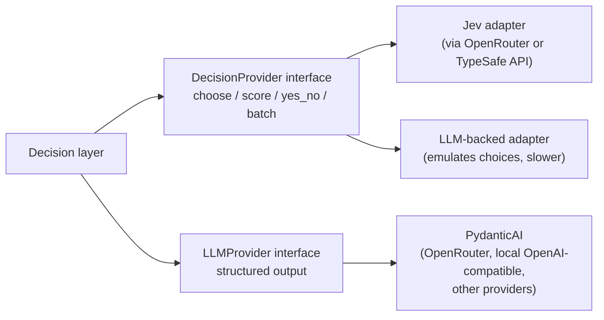

# 12. Decision Layer

Status: Proposed (decision-model tier moves to phase 2, ADR-0025) · Phase 1 · Lives in: `eng-harness`

## 1. The cascade

Every decision point declares typed options and a policy. The engine resolves it in this order and stops at the first
tier that produces an accepted answer:



| Tier | What it is | Speed | When it is used |
|---|---|---|---|
| 1. Rules | Ordered pure functions over the typed state, each with an id, specified by the engineer in the workflow spec. Thresholds come only from the design basis; no numeric literals | under 1 ms | Always first. Most decisions should end here |
| 2. Decision model | A typed decision model such as TypeSafe Jev: choice, score, yes/no, each with confidence | sub-second | When rules do not match and the policy allows a model. From phase 2 ([ADR-0025](../adr/0025-first-workflow-edit-cycle.md)), for one decision point in shadow mode |
| 3. Language model | A general model through PydanticAI with a strict output type: one of the options plus a short rationale that may not contain digits | seconds | From phase 2, only when the policy allows it, for decisions that need unstructured context |
| 4. Engineer | A prompt in the UI (in phase 1, the local page of [ADR-0027](../adr/0027-phase-1-interface.md)) with the options, the evidence and every lower tier's suggestion; several open decisions of one point are shown on one batched screen | human | When no tier is accepted, or the policy requires the engineer |

## 2. Decision points

```python
class FootingAction(StrEnum):
    ENLARGE_PLAN = "enlarge_plan"
    INCREASE_DEPTH = "increase_depth"
    COMBINE_WITH_NEIGHBOR = "combine_with_neighbor"
    ASK_ENGINEER = "ask_engineer"

choice = await ctx.decide(
    question="footing_fix_strategy",
    options=FootingAction,
    state=FootingFailureState(...),        # typed, minimal, redacted
    rules=FOOTING_RULES,                    # e.g. bearing FAIL only -> ENLARGE_PLAN
    policy=DecisionPolicy(model=True, llm=False, min_confidence=0.85),
)
```

Rules for decision points:

1. Options are an enum, or an index into a list of references built by the block. A decision never returns a number.
2. The state is a Pydantic model with only what the decision needs: statuses, ratios, counts, short labels. No file
   contents, project names, client names or locations (redaction is by construction).
3. Every decision point has a stable name, so its history can be evaluated over time.
4. `ctx.decide_many` sends several questions in one request where the provider supports batching.

## 3. Policy

| Field | Meaning | Default |
|---|---|---|
| `model` | Allow tier 2 | true |
| `llm` | Allow tier 3 | false |
| `min_confidence` | Threshold to accept a tier-2 answer | 0.85 |
| `shadow` | Run tier 2 or 3 but always ask the engineer, showing the suggestions on one batched screen per decision point (counted as one engineer prompt) | true until the point passes its evaluation (§6) |
| `timeout_ms` | Per-tier timeout before falling through | 1500 for tier 2, 20000 for tier 3 |

## 4. Providers



- Provider settings: endpoint, model id, key, timeouts. Defaults: OpenRouter, with a decision model id such as
  `typesafe/jev-1.13` and a general model chosen by the owner.
- Local or private endpoints are supported for both interfaces (OpenAI-compatible APIs such as a local model server).
- The Jev request format (TypeSafe's System One API versus access through OpenRouter) is settled by spike S-07; the
  adapter hides it.
- Keys are stored in the operating system's credential store, never in project files or logs.
- Every network call has a timeout. A provider failure falls through to the next tier and is recorded; it never
  blocks a run silently.

## 5. Records

Each decision appends a `decision_made` event: decision point name, options, chosen option, decided by
(`rule:<id>`, `model:<provider>/<model>@<version>`, `llm:<...>`, or `engineer:<name>`), confidence, latency, a hash of
the state, and the suggestions of the other tiers when they ran.

## 6. Learning without drift

- Engineer decisions and overrides are stored as labeled examples per decision point, inside the workspace. Export is
  opt-in.
- Each decision point has an evaluation set. Tier 2 or 3 leaves shadow mode for a point only when its evaluation
  passes: at least 50 labeled cases, at least 95% agreement with the engineer among answers above the confidence
  threshold, and acceptable calibration. Thresholds can only be raised per point, not lowered below these defaults.
- The owner may take a specific low-risk point out of shadow mode earlier (for example DXF layer classification,
  where every result is visible in the approval preview). That is an explicit, recorded setting per decision point,
  never a global switch.
- New rules are proposed from the data but always written and approved by a human through the normal process. The
  system never edits its own rules.
