# 01. Lifecycle: Stages, Gates, Tiers

## 1. Stages and gates

```mermaid
flowchart LR
    S0["S0 Intake"] --> S1["S1 Discovery"] --> S2["S2 Spec"] --> G1{{"G1 Spec merged as approved"}}
    G1 --> S3["S3 Plan"] --> G2{{"G2 Plan merged as approved"}}
    G2 --> S4["S4 Implement (TDD)"] --> S5["S5 Pre-checks"] --> S6["S6 Pull request, CI, reviews"] --> G3{{"G3 Merge"}}
    G3 --> S7["S7 Live acceptance (per release)"] --> G4{{"G4 Release"}} --> S8["S8 Release"] --> S9["S9 Learn"]
```

| Stage | Output | Exit condition |
|---|---|---|
| S0 Intake | An issue from a template | Triaged: accepted, rejected, or needs information; claimed by one assignee |
| S1 Discovery | Problem statement, acceptance criteria, reuse research | The problem is measurable; reuse options were checked |
| S2 Spec | Spec file of the right type ([03](03-specs-and-design-review.md)); an ADR if architecture changes | Spec review checklist passes |
| **G1** | The spec merged to `main` through its own pull request, front matter `status: approved` | Approvals per §5, verified by the `gate-check` CI job |
| S3 Plan | Plan file `docs/plans/<issue>-<slug>.md` ([templates/implementation-plan.md](templates/implementation-plan.md)) | Every acceptance criterion maps to a test; every task lists its files, size estimate and session estimate |
| **G2** | The plan merged to `main` through its own pull request, `status: approved` | Approvals per §5, verified by `gate-check` |
| S4 Implement | Per task: a `test:` commit with failing tests, then code, then refactor | Task tests green |
| S5 Pre-checks | Local gate (`uv run eng-gate check`) and optional author-side review tools | Local gate green |
| S6 Pull request | PR from the template naming its plan task; CI runs the gate, `gate-check`, `risk-floor`, `test-first` and the CI reviewers | All required checks green; findings resolved |
| **G3** | Merge | Approvals per §5 |
| S7 Live acceptance | Before each release that touches host code: acceptance scripts run by the owner on the real host; the scripts write the record | Records committed for every supported host version |
| **G4** | Release approval | Release checklist passes; owner approves |
| S8 Release | Tag, build, publish, changelog | Artifacts published |
| S9 Learn | Lessons filed as issues; process changes proposed as pull requests | Retro note on the milestone |

## 2. Size tiers

| Tier | Definition (any signal raises the tier) | Stages |
|---|---|---|
| trivial | Documentation or comments only; or at most 10 changed lines with no change to `src/` logic, schemas, tests' expectations or configuration | S0, S4, S5, S6, G3 |
| small | One function or one file; one task; behavior is clear | All stages, with a **light spec** (the issue's acceptance criteria) and a **light plan** (one task, in the plan file) |
| standard | Two to five files; one real design choice; a new tool, check or block | All stages |
| large | Cross-cutting; new dependency; public API; new repository; contract change | All stages, with an ADR; several tasks |

## 3. Risk classes

Risk overrides size: R1 and R2 are at least **standard**. The risk recorded in the approved plan is binding for
every pull request of that plan, and the `risk-floor` CI job raises it automatically from the paths a pull request
touches (§6).

| Class | Definition | Extra requirements |
|---|---|---|
| R0 | No effect on engineering output, contracts or security | None |
| R1 Engineering | Can change a number, a verdict, a unit, a model write, a template value, a calc function, a decision rule or policy | [10-engineering-verification](10-engineering-verification.md) |
| R2 Contract | Changes `eng-contract`, a tool's public schema, a kind, or a cross-repository interface | ADR; consumers listed; version impact stated |
| R3 Security | Touches secrets, providers, network, pipes, file paths from input, UI exposure, or runtime dependencies | Security reviewer at G3 and on the spec |

Automated dependency updates of patch versions and development dependencies are tier small, risk R0, and may merge
automatically on green CI ([12](12-operations.md) §6). Runtime dependency additions and major upgrades are R3.

## 4. How gates are recorded

Gates are files and pull-request approvals on `main`, never labels or comments, so CI can verify them:

- Specs and plans carry YAML front matter: `id`, `issue`, `status` (`draft` or `approved`), `size`, `risk`, and for
  plans the task list with `files` (globs), `max_changed_lines` (an estimate, [04](04-implementation-rules.md) §4) and
  `max_sessions` (an estimate, [04](04-implementation-rules.md) §4) per task.
- A spec or plan becomes approved only by merging the pull request that sets `status: approved`, with the approvals
  required in §5. A pull request that changes a spec or a plan changes nothing else.
- An implementation pull request names `Plan-Task: docs/plans/<file>#T<n>` in its description. The `gate-check` job
  verifies that the plan and its spec are approved on `main`, the task exists, and every changed file matches the
  task's globs. Diff size is reported, never failed ([04](04-implementation-rules.md) §4).
- Labels (`status/`, `size/`, `risk/`) are informational and for search; no gate depends on them.
- Bootstrap mode ([ADR-0028](../docs/adr/0028-build-v1-in-this-repository.md)): gates are verified on `build/v1`
  instead of `main`; a spec or plan with `status: draft` that a subagent other than its author reviewed stands in for
  G1 and G2; a check that needs the owner or another identity reports `awaiting owner` instead of failing.

## 5. Who approves

"Reviewer bot" means the CI-run reviewers ([06](06-review-and-merge.md) §1), posting under the reviewer identity.
"Owner" means the owner's GitHub account, and nothing else ([11](11-repository-standard.md) §6).

| Gate | R0 | R1 | R2 | R3 |
|---|---|---|---|---|
| G1 spec | Reviewer bot | **Owner** (including the verification cases) | **Owner**, after architecture review | Reviewer bot and security reviewer |
| G2 plan | Reviewer bot (large: owner) | Reviewer bot (large: owner) | Reviewer bot (large: owner) | Reviewer bot |
| G3 merge | CI and reviewer bot | CI and two reviewer bots of different model families; **owner** when golden data, cited constants, approvals, templates, decision rules or policies change | CI and reviewer bots; **owner** when the generated schema snapshot changes | CI, reviewer bot and security reviewer |
| G4 release | Owner | Owner | Owner | Owner |

The owner also samples delegated merges ([12](12-operations.md) §5).

## 6. Risk floor by path

Each repository keeps `.gate/risk-map.yml`, which maps paths to a minimum risk. Defaults:

| Paths | Minimum risk |
|---|---|
| Code-pack checks, golden data, `approvals.yaml`, calc functions, units, shipped templates, decision rules and policies, server write paths (`service/`, `host/`) | R1 |
| Tool schemas, kinds, generated schema snapshots, everything in `eng-contract` | R2 |
| Dependency manifests, network or provider code, pipe servers, file-path handling, UI server | R3 |

A pull request whose recorded risk is below the floor fails `risk-floor`.

## 7. Work in progress

- One work item per agent session; the claiming identity is the issue's assignee.
- At most three open pull requests per repository from agents.
- Each plan task has a session estimate (`max_sessions`). Exceeding it is recorded in the handoff note, never a stop.
  Changed lines have no limit ([04](04-implementation-rules.md) §4).
- A work item blocked for more than five working days is re-triaged.

## 8. Change types and their first move

| Type | First move |
|---|---|
| Feature | Spec and acceptance criteria |
| Change of behavior | Spec change pull request, then tests to the new behavior, then code |
| Defect | Reproduce as a failing regression test |
| Refactor | Confirm tests green; change structure only; tests stay green without edits |
| Gap report | Triage: new spec, covered, host limitation, or out of scope. During a live project: the project lane (§9) when the owner asks, otherwise a need in the task log (§10) |
| Need from a task log | Triage in a development session (§10, [02](02-work-items.md) §5) |
| Spike | Question, time box, throwaway code in `spikes/`, report |
| Contract change | ADR in the hub first |
| Code clause | Clause spec ([10](10-engineering-verification.md) §3) |
| Workflow | Workflow spec from the owner ([templates/workflow-spec.md](templates/workflow-spec.md)) |
| Emergency (wrong result in the field, leaked secret, broken release) | [12-operations](12-operations.md) §1 |

## 9. Project lane

During a live project, when the owner asks for it, a missing capability is built through the project lane
([ADR-0026](../docs/adr/0026-project-lane-for-tools.md)) instead of waiting for G1 and G2; otherwise the agent logs the
need and goes on (§10).

| Item | Rule |
|---|---|
| Trigger | The owner asks for the capability in the live session; that request is the approval |
| Branch | `lane/<issue-number>-<slug>` in the repository that owns the tool, where the issue is the gap report filed at the start; never `main` |
| Tests | A test for every number the tool produces or writes, against a cited source or a hand check |
| Live check | On a copy of the model or a fixture, in the owner's live session; never on the working model |
| Use | In the project only on a copy; the run report marks every result that depends on the tool |
| Record | The session report, which is the task log of the lane session (§10; what was built, the tests, the live check, open risks), and the gap report, unchanged |
| CI | Tests and `risk-floor` run on lane branches; `gate-check` and `test-first` run in the release lane |
| Release lane | Before merge to `main` or use in another project: the full lifecycle from S2, starting from the branch |

Open lane branches appear in the owner digest ([12](12-operations.md) §7); one older than 30 days is re-triaged.

## 10. Live work and the task log

Every task the owner asks of the agent has exactly one task log in the root folder `tasklog/` of the workspace
repository ([ADR-0034](../docs/adr/0034-task-log-by-default.md); D1 defines a task, D5 how logs travel).

| Session | Rule |
|---|---|
| Live (the owner asks for project work; a project-lane session included) | The agent completes what is possible only through harness workflows, records everything in the task log, and changes no other repository file. A missing capability is a `not_found` record and the agent goes on (ADR-0034 D2) |
| Development (started on a work item, under the full process) | Develops the core; a live session never does. It may read the full logs, triages their needs ([02](02-work-items.md) §5) and files gap issues citing need ids only (A24, ADR-0034 D11) |
| Any other | Never opens `tasklog/` |
